<p align="center">
  <picture>
    <source media="(prefers-reduced-motion: reduce)" srcset="assets/branding/aurel-hero-banner-static.svg">
    
  </picture>
</p>

<p align="center">
  <strong>Product Design Concept</strong> · <strong>Interactive Mobile Prototype</strong> · <strong>Proposed Social Platform Architecture</strong>
</p>

<p align="center">
  <a href="design/AUREL-Social.figcraft">Editable FigCraft File</a> ·
  <a href="docs/PRODUCT_OVERVIEW.md">Product Overview</a> ·
  <a href="docs/LIQUID_GLASS.md">Liquid Glass System</a> ·
  <a href="docs/DESIGN_SYSTEM.md">Design System</a> ·
  <a href="docs/ARCHITECTURE.md">Proposed Architecture</a> ·
  <a href="docs/ROADMAP.md">Roadmap</a>
</p>

---

## Beyond Connection

**AUREL** is an original mobile social super app concept by **NGOPREK DIGITAL** built around one straightforward premise: *Connect with people. Discover more. Think together.*

Modern communication is fragmented across separate messaging clients, photography feeds, vertical short-video apps, community forums, and standalone AI assistants. AUREL brings these five modes into one coherent iOS-first interface governed by a restrained Liquid Glass material hierarchy and explicit opt-in privacy boundaries.

| Deliverable | Verified Count | Source |
| :--- | :--- | :--- |
| Organized FigCraft pages | **12 pages** | [`design/AUREL-Social.figcraft`](design/AUREL-Social.figcraft) |
| Mobile product screens (`402 x 874 px`) | **44 screens** (36 light + 8 dark) | [`previews/`](previews/) |
| Total exported artboards & boards | **54 artboards** | [`previews/`](previews/) & [`assets/`](assets/) |
| Native reusable FigCraft components | **25 components** | Page 09 (Liquid Glass Design System) |
| Design variables & collections | **25 variables** across **2 collections** | `AUREL Colors` (Light/Dark) + `AUREL Scale` |
| Interactive prototype flows | **7 flows** (`25` wired transitions) | Page 11 (Motion & Interactive Prototype) |

> **Project Transparency Notice**
> This private repository contains a completed **Product Design Concept**, an **Interactive FigCraft Prototype**, and a **Proposed Technical Architecture** for future development. No backend servers, real-time messaging infrastructure, encryption protocols, live AI inference endpoints, or production mobile code have been implemented yet. AUREL is an independent concept and has no affiliation with Apple, Meta, WhatsApp, Telegram, Instagram, or TikTok.

---

## Flagship Product Showcase

<p align="center">
  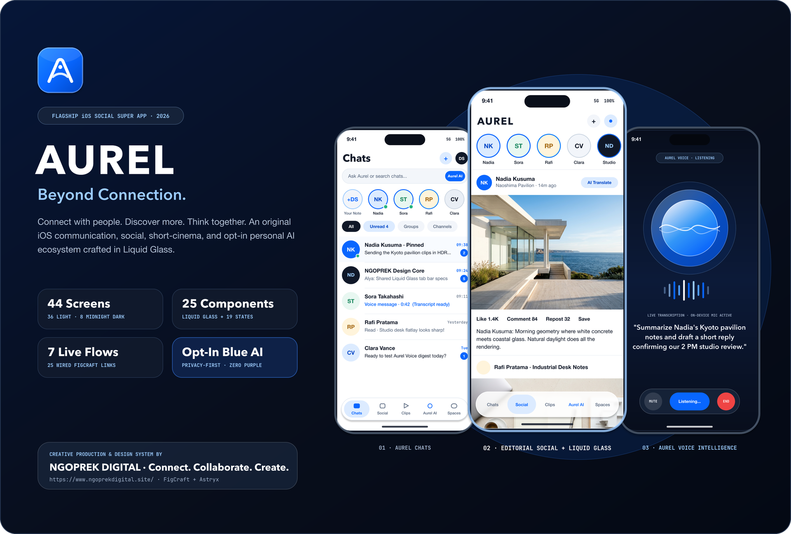
</p>

<p align="center">
  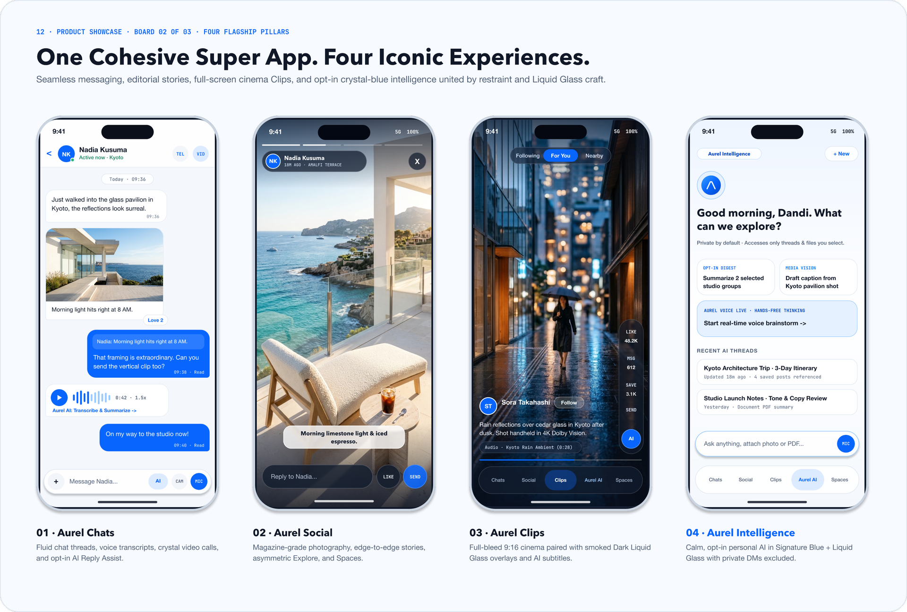
</p>

### Eight Core Experiences at a Glance

<table>
  <tr>
    <td align="center" width="25%">
      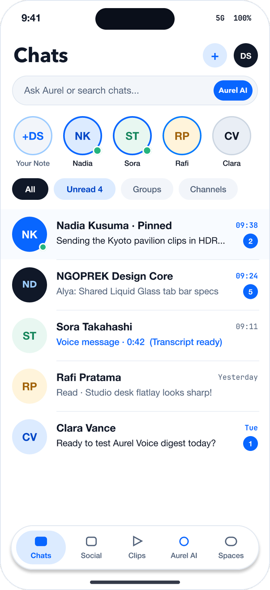<br>
      <sub><strong>05 · Chats Home</strong></sub>
    </td>
    <td align="center" width="25%">
      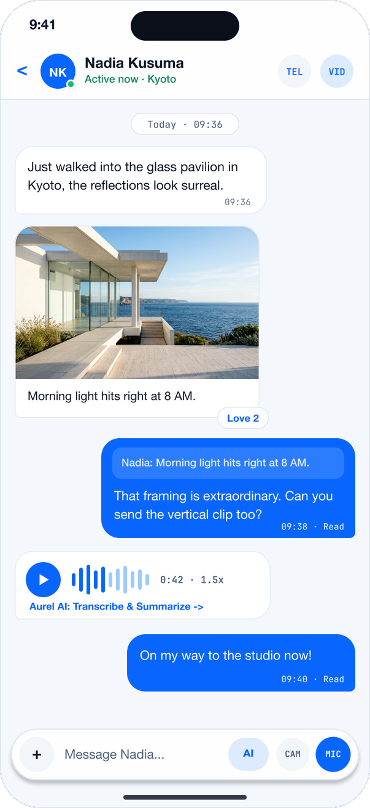<br>
      <sub><strong>06 · Personal Conversation</strong></sub>
    </td>
    <td align="center" width="25%">
      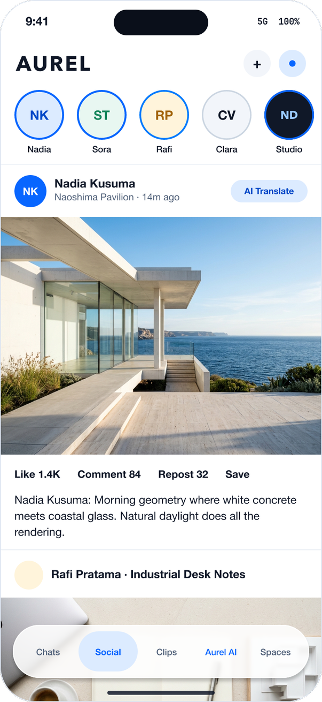<br>
      <sub><strong>13 · Social Feed</strong></sub>
    </td>
    <td align="center" width="25%">
      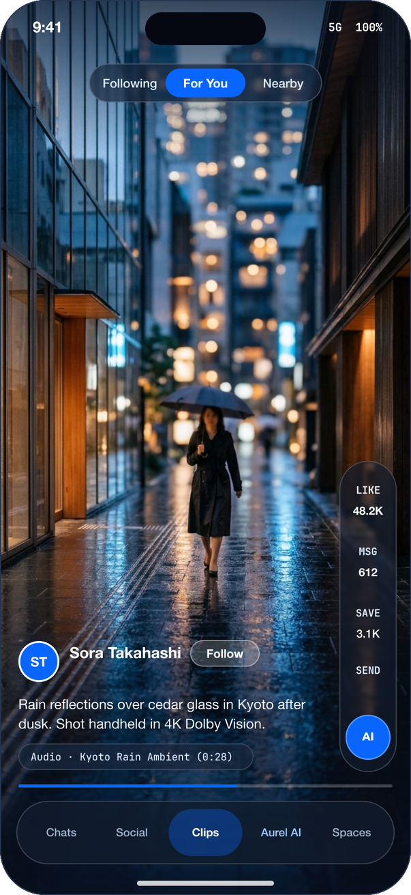<br>
      <sub><strong>20 · Immersive Clips</strong></sub>
    </td>
  </tr>
  <tr>
    <td align="center" width="25%">
      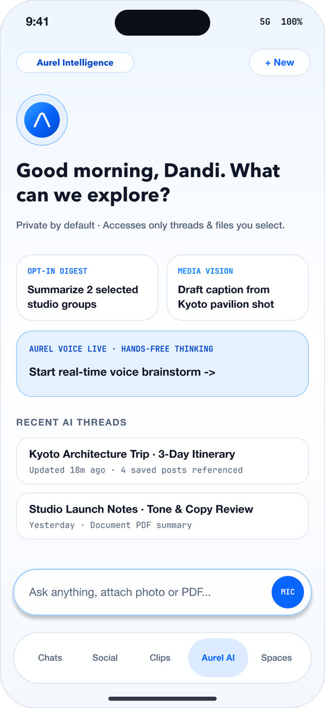<br>
      <sub><strong>25 · Aurel Intelligence</strong></sub>
    </td>
    <td align="center" width="25%">
      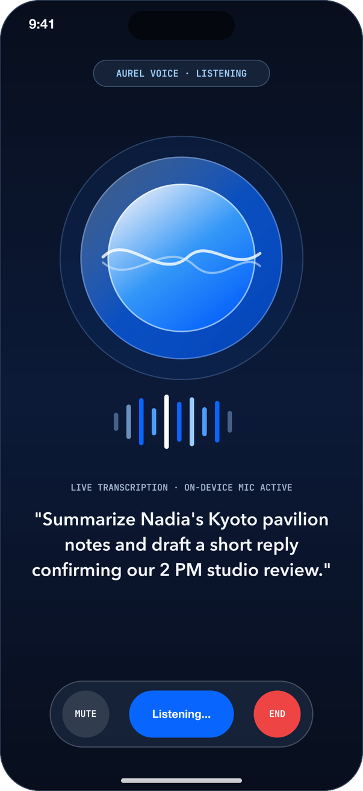<br>
      <sub><strong>27 · AI Voice Orb</strong></sub>
    </td>
    <td align="center" width="25%">
      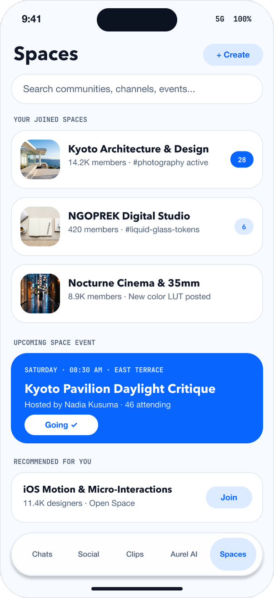<br>
      <sub><strong>30 · Aurel Spaces</strong></sub>
    </td>
    <td align="center" width="25%">
      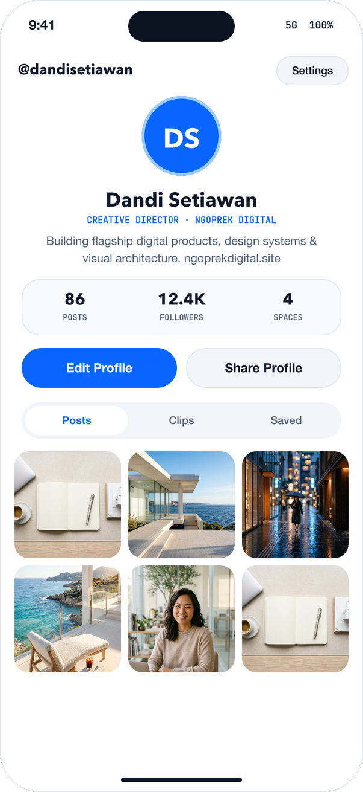<br>
      <sub><strong>33 · Personal Profile</strong></sub>
    </td>
  </tr>
</table>

---

## AUREL Ecosystem

AUREL connects six product areas through shared identity, consistent navigation geometry, and an optional intelligence layer that operates only on spaces, threads, or files explicitly authorized by the user.

<p align="center">
  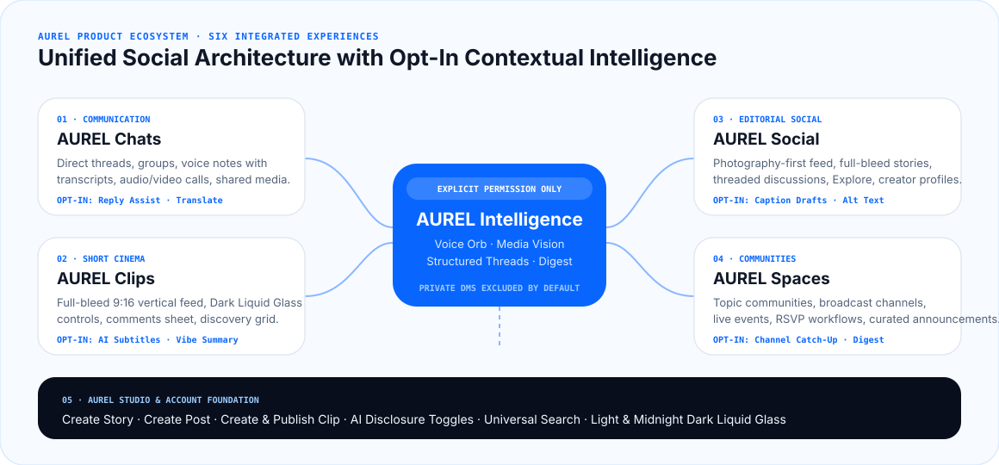
</p>

<details>
  <summary>View conceptual ecosystem connection motion (SVG animation)</summary>
  <p align="center">
    <picture>
      <source media="(prefers-reduced-motion: reduce)" srcset="assets/diagrams/aurel-ecosystem-architecture.svg">
      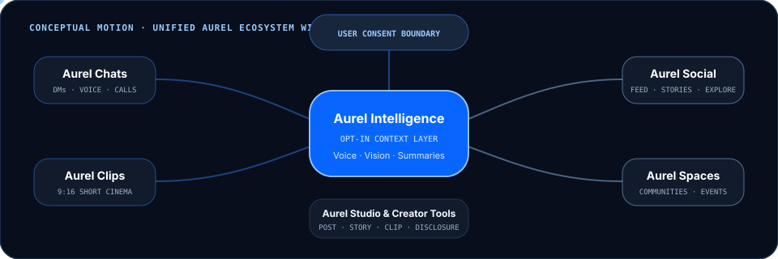
    </picture>
  </p>
</details>

---

## AUREL Chats

Messaging in AUREL prioritizes legible reading surfaces (`#FFFFFF` in Light Mode, `#080E1C` in Dark Mode) while reserving translucent Liquid Glass strictly for floating headers, composers, voice players, and opt-in assistance sheets.

<table>
  <tr>
    <td align="center" width="25%">
      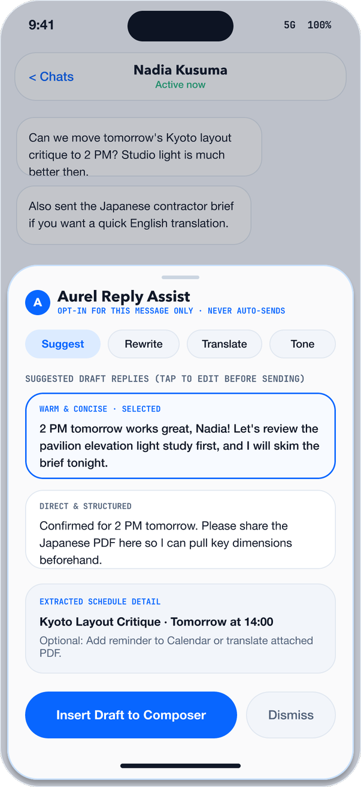<br>
      <sub><strong>07 · AI Reply Assist Sheet</strong><br>Draft insertion requires explicit tap</sub>
    </td>
    <td align="center" width="25%">
      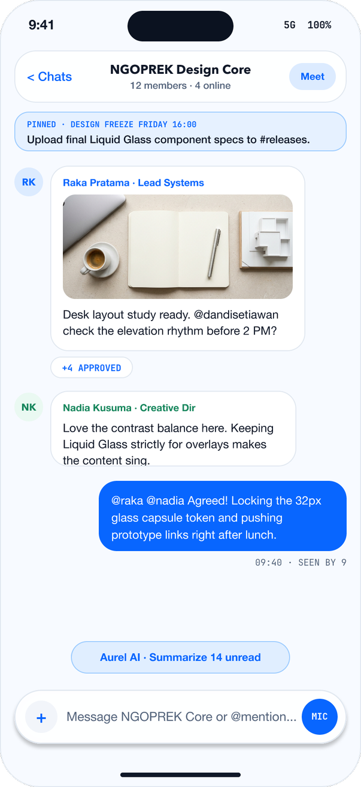<br>
      <sub><strong>08 · Group Conversation</strong><br>Mentions, pins, reactions, catch-up</sub>
    </td>
    <td align="center" width="25%">
      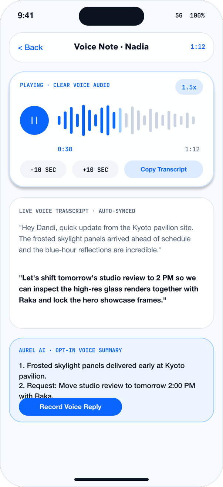<br>
      <sub><strong>09 · Voice &amp; Transcript</strong><br>Waveform, 1.5x speed, opt-in summary</sub>
    </td>
    <td align="center" width="25%">
      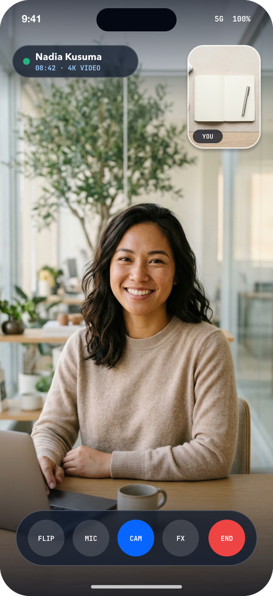<br>
      <sub><strong>11 · Video Call</strong><br>Self-view PiP &amp; dark glass controls</sub>
    </td>
  </tr>
</table>

Additional completed messaging screens include [Audio Call (`10-audio-call.png`)](previews/chats/10-audio-call.png) and [Shared Media (`12-shared-media.png`)](previews/chats/12-shared-media.png) covering Photos, Videos, Links, Files, and Voice tabs.

<p align="center">
  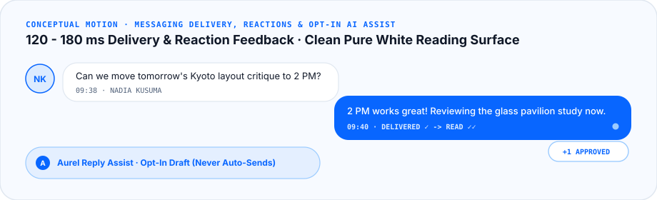
</p>

> **Designed vs. Implemented**: All messaging layouts, delivery receipt states, voice playback sheets, call controls, translation/reply drafts, and group catch-up pills are UI/UX design specifications in FigCraft. Real-time WebSocket delivery, WebRTC media calling, and live speech transcription are planned in [`docs/MESSAGING.md`](docs/MESSAGING.md) and [`docs/ARCHITECTURE.md`](docs/ARCHITECTURE.md).

---

## AUREL Social

AUREL Social treats photography and visual writing with editorial restraint: generous breathing room, edge-to-edge stories, asymmetric masonry discovery in Explore, threaded comments, and clear disclosure controls during publishing.

<table>
  <tr>
    <td align="center" width="25%">
      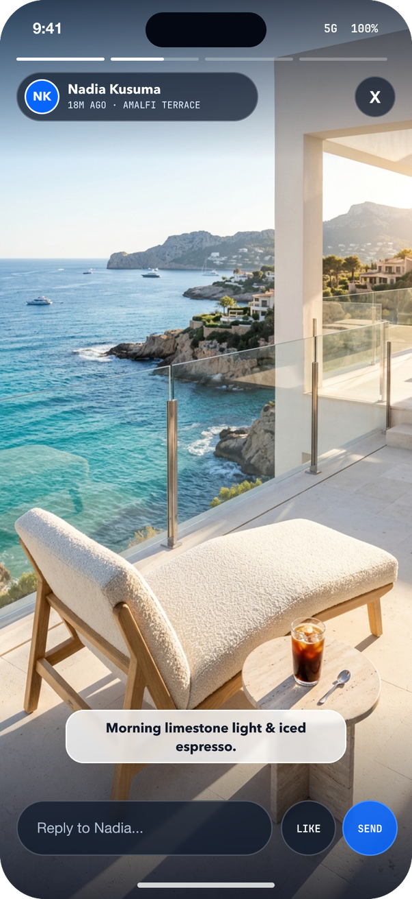<br>
      <sub><strong>14 · Story Viewer</strong><br>Translucent progress &amp; reply dock</sub>
    </td>
    <td align="center" width="25%">
      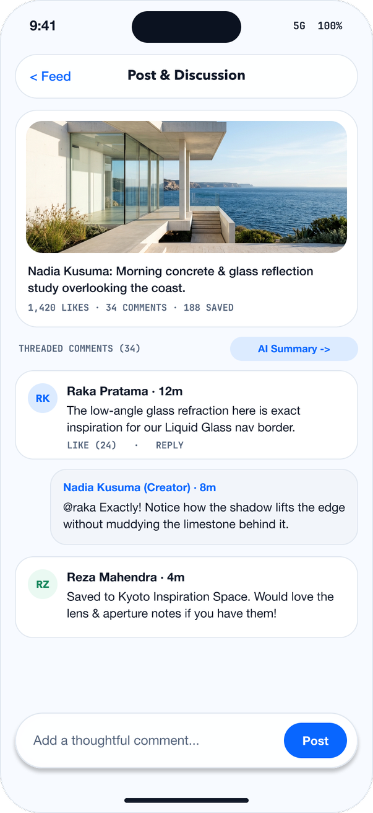<br>
      <sub><strong>16 · Post &amp; Discussion</strong><br>Nested replies &amp; glass composer</sub>
    </td>
    <td align="center" width="25%">
      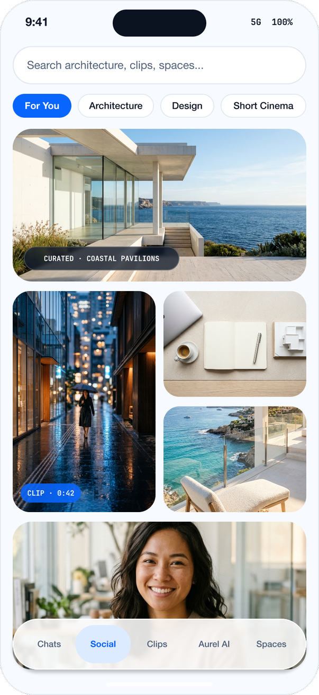<br>
      <sub><strong>17 · Editorial Explore</strong><br>Masonry media &amp; live nav refraction</sub>
    </td>
    <td align="center" width="25%">
      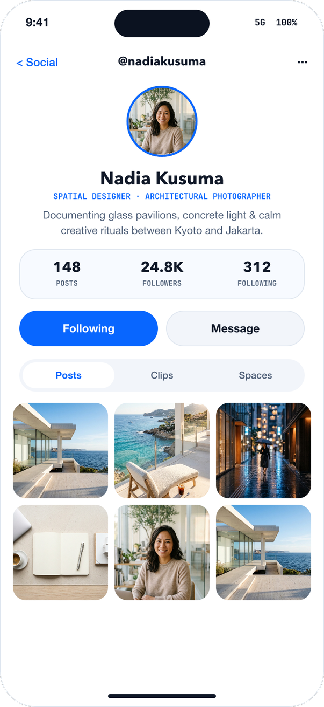<br>
      <sub><strong>19 · Creator Profile</strong><br>Stats, Follow/Message, 3-column grid</sub>
    </td>
  </tr>
</table>

Creator publishing flows are covered in [Create Story (`15-create-story.png`)](previews/social/15-create-story.png) and [Create Post (`18-create-post.png`)](previews/social/18-create-post.png), including optional AI caption suggestions and an explicit AI-assisted content disclosure toggle. Full notes live in [`docs/SOCIAL_PLATFORM.md`](docs/SOCIAL_PLATFORM.md).

---

## AUREL Clips

AUREL Clips presents full-screen 9:16 short video inside a dark cinema environment (`#080E1C`) where smoked Dark Liquid Glass controls keep the frame clear while surfacing playback switches, comments, and creator tools.

<table>
  <tr>
    <td align="center" width="25%">
      <br>
      <sub><strong>20 · Immersive Feed</strong><br>Top glass switcher &amp; reaction rail</sub>
    </td>
    <td align="center" width="25%">
      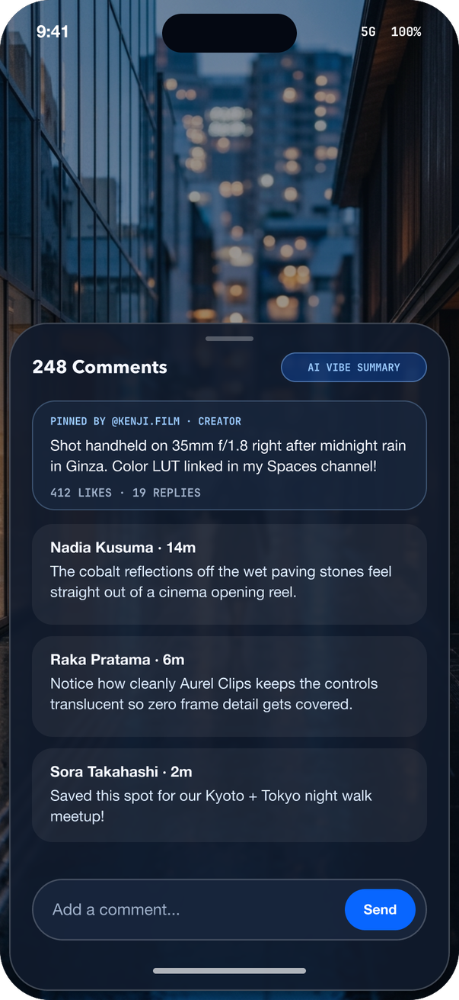<br>
      <sub><strong>21 · Video Comments</strong><br>Frosted midnight bottom sheet</sub>
    </td>
    <td align="center" width="25%">
      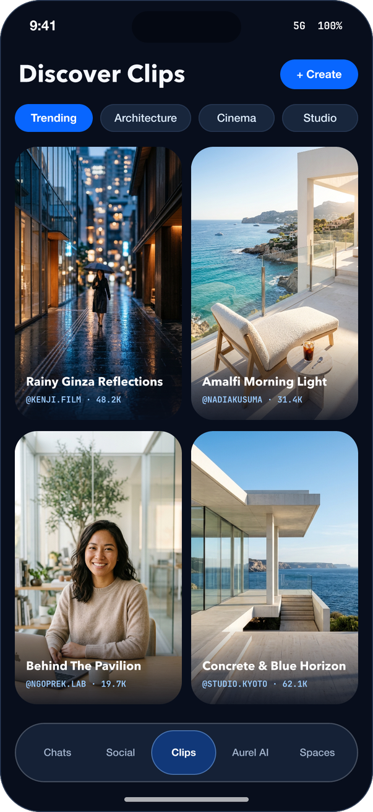<br>
      <sub><strong>22 · Video Discovery</strong><br>Curated vertical cinema categories</sub>
    </td>
    <td align="center" width="25%">
      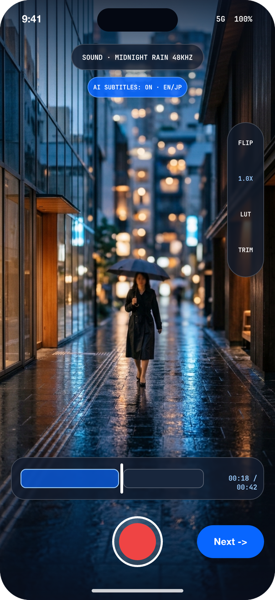<br>
      <sub><strong>23 · Create Clip</strong><br>Timeline trim &amp; AI subtitles toggle</sub>
    </td>
  </tr>
</table>

Publishing and viewer disclosure settings are detailed in [Clip Publishing (`24-clip-publishing.png`)](previews/clips/24-clip-publishing.png) and [`docs/SHORT_VIDEO.md`](docs/SHORT_VIDEO.md).

---

## AUREL Intelligence

Aurel Intelligence breaks away from generic purple AI branding. Every AI surface uses AUREL's Signature Blue (`#0866FF`), Crystal Blue (`#9BCBFF`), Pure White (`#FFFFFF`), and Midnight Navy (`#080E1C`) language. Intelligence operates strictly as an **opt-in contextual layer**: private direct messages are excluded by default, every digest displays its exact authorized sources, and drafted replies never auto-send without explicit user confirmation.

<table>
  <tr>
    <td align="center" width="25%">
      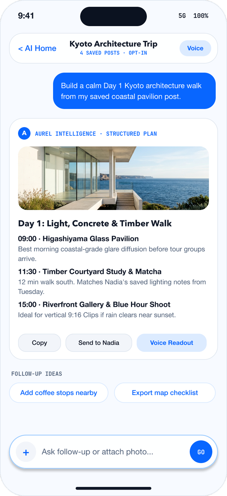<br>
      <sub><strong>26 · AI Conversation</strong><br>Structured plan, photo ref, voice readout</sub>
    </td>
    <td align="center" width="25%">
      <br>
      <sub><strong>27 · Aurel Voice Live</strong><br>Blue optical orb &amp; live transcription</sub>
    </td>
    <td align="center" width="25%">
      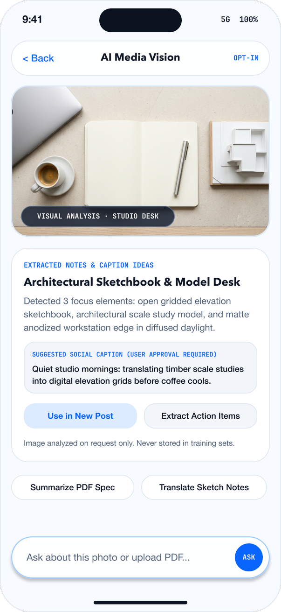<br>
      <sub><strong>28 · AI Media Vision</strong><br>On-request photo &amp; PDF notes</sub>
    </td>
    <td align="center" width="25%">
      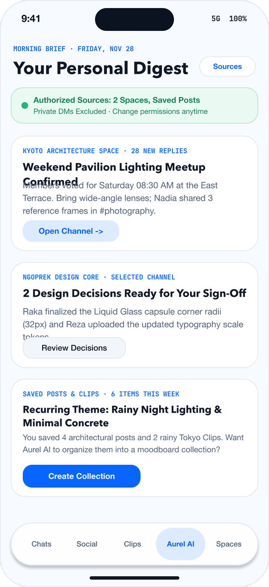<br>
      <sub><strong>29 · Personal Digest</strong><br>Authorized sources banner · DMs excluded</sub>
    </td>
  </tr>
</table>

<p align="center">
  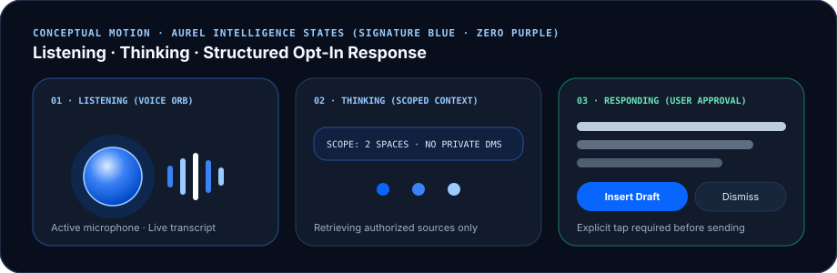
</p>

See [`docs/AI_INTELLIGENCE.md`](docs/AI_INTELLIGENCE.md) and [`docs/PRIVACY.md`](docs/PRIVACY.md) for the complete permission model.

---

## Liquid Glass Design System

Liquid Glass in AUREL follows a strict **restraint rule**: translucency and backdrop blur belong on floating navigation capsules, composers, search bars, contextual sheets, and media overlays, never on dense reading backgrounds or long-form chat transcripts.

<p align="center">
  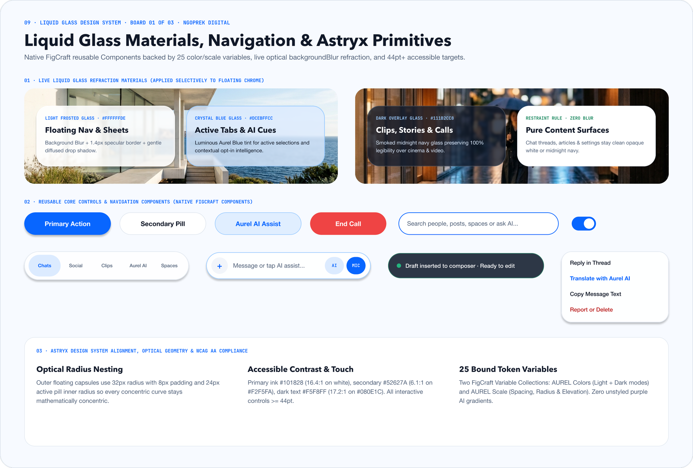
</p>

<p align="center">
  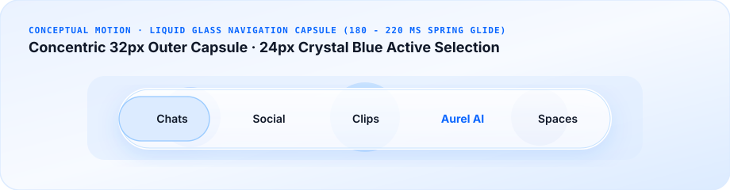
</p>

| Material Tier | Fill Token | Border &amp; Optical Treatment | Intended Use |
| :--- | :--- | :--- | :--- |
| **Light Frosted Glass** | `#FFFFFFDE` | `1.2px` `#FFFFFFEE` / `#E0E7F0`, `backgroundBlur`, soft shadow | Floating bottom nav, chat composer, glass headers |
| **Crystal Blue Glass** | `#DCEBFFCC` | `1.5px` `#9BCBFF`, `backgroundBlur` | Active tab capsules, opt-in AI prompt chips |
| **Dark Overlay Glass** | `#111B2CC8` | `1.2px` `#FFFFFF38`, `backgroundBlur` | Clips reaction rail, Story reply bar, Video Call deck |
| **Pure Reading Surface** | `#FFFFFF` / `#080E1C` | `1px` `#E0E7F0` / `#253550`, **zero blur** | Chat streams, feed cards, settings, long-form text |

> **Rendering Disclosure**: Translucency previews inside `AUREL-Social.figcraft` use FigCraft's native `backgroundBlur` and `dropShadow` effects. Production iOS optical refraction shaders (`SwiftUI` `.ultraThinMaterial` / Metal glass layers) are specified for future mobile engineering in [`docs/LIQUID_GLASS.md`](docs/LIQUID_GLASS.md) and are not yet implemented in native iOS code.

---

## Light and Dark Experience

Dark Mode is authored independently on **Midnight Navy (`#080E1C`)** and **Deep Slate (`#111B2C`)** surfaces with smoked Dark Liquid Glass (`#18263CCC`) and calibrated high-contrast ink (`#F5F8FF` primary, `#9FB0C9` secondary) rather than mechanical color inversion.

<p align="center">
  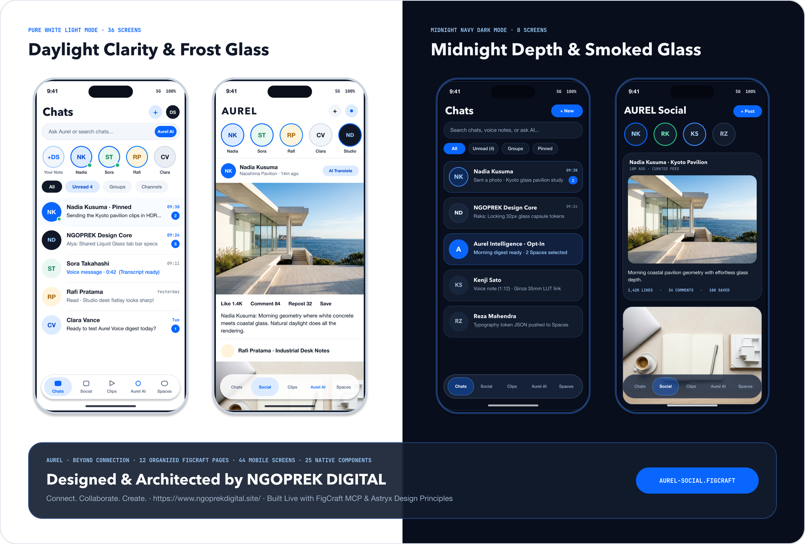
</p>

<table>
  <tr>
    <td align="center" width="25%">
      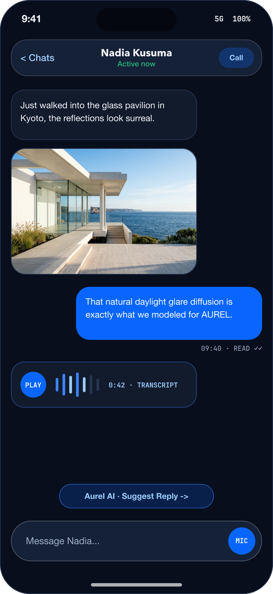<br>
      <sub><strong>Dark 02 · Conversation</strong></sub>
    </td>
    <td align="center" width="25%">
      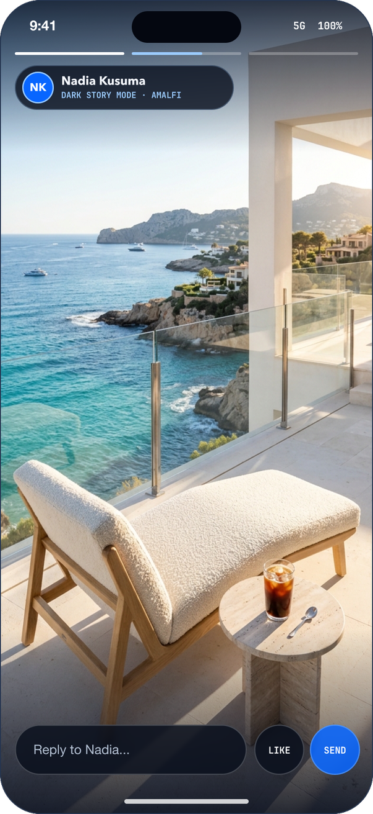<br>
      <sub><strong>Dark 04 · Story Viewer</strong></sub>
    </td>
    <td align="center" width="25%">
      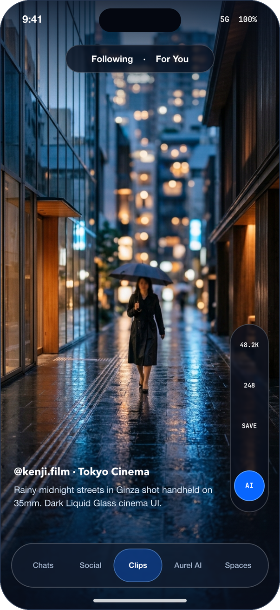<br>
      <sub><strong>Dark 05 · Clips Feed</strong></sub>
    </td>
    <td align="center" width="25%">
      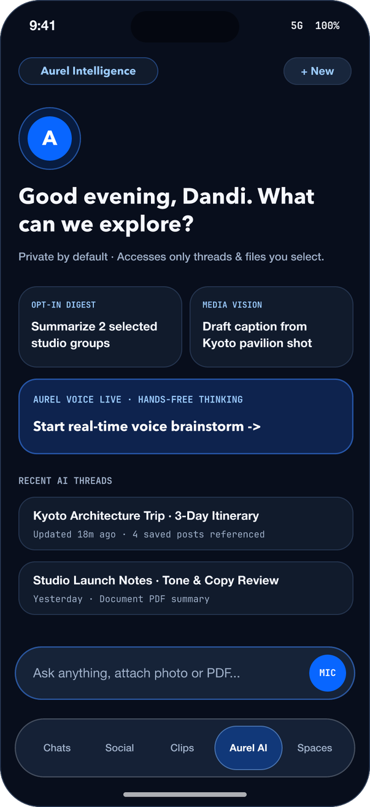<br>
      <sub><strong>Dark 06 · AI Assistant</strong></sub>
    </td>
  </tr>
</table>

All 8 Midnight Navy screens (including [Dark Chats Home](previews/dark-mode/dark-01-chats-home.png), [Dark Social Home](previews/dark-mode/dark-03-social-home.png), [Dark AI Conversation](previews/dark-mode/dark-07-ai-conversation.png), and [Dark Personal Profile](previews/dark-mode/dark-08-personal-profile.png)) are stored in [`previews/dark-mode/`](previews/dark-mode/).

---

## Design System

Every screen draws from verified tokens and native FigCraft components built on Page 01 and Page 09, aligned with Astryx accessibility standards (`>= 44pt` touch targets, `4.5:1+` WCAG AA body contrast, and concentric corner-radius nesting).

### Brand Palette & Semantic Tokens

| Token | Light Mode | Dark Mode | Role |
| :--- | :--- | :--- | :--- |
| Signature Blue | `#0866FF` | `#0866FF` | Primary CTAs, outgoing bubbles, active AI emblem |
| Interaction Blue | `#007AFF` | `#3B82F6` | Interactive links, hover states, active borders |
| Deep Blue | `#0047C7` | `#0E234E` | Pressed buttons, depth gradients, featured AI cards |
| Crystal / Glacier Blue | `#9BCBFF` / `#DCEBFF` | `#9BCBFF` / `#18263C` | Active nav capsule, subtle accents, dark ink tags |
| Canvas Background | `#F7FAFF` / `#FFFFFF` | `#080E1C` | Primary page canvas and clean reading backdrop |
| Elevated Surface | `#FFFFFF` / `#F2F5FA` | `#111B2C` | Cards, grouped lists, input fields |
| Primary / Secondary Text | `#101828` / `#52627A` | `#F5F8FF` / `#9FB0C9` | High-contrast body copy and metadata |
| Semantic Status | `#24B47E` / `#F59E0B` / `#EF4444` | `#24B47E` / `#F59E0B` / `#EF4444` | Consent active, offline warning, destructive/error |

### Typography, Components & 19 Documented States

- **Typefaces**: `Avenir Next` (`Demi Bold`, `Bold`) for display headers and brand marks; `Helvetica Neue` (`Regular`, `Medium`, `Bold`) for body copy and chat streams; `JetBrainsMonoNL Nerd Font` for timestamps, durations, and technical metadata.
- **Verified Inventory**: **25 native FigCraft Components** (`type: component`), **2 Variable Collections** (`AUREL Colors`, `AUREL Scale`), **25 bound design variables**, **19 interactive/messaging/AI/system states**, and **5 empty states** across Chats, Saved Posts, Spaces, Notifications, and AI threads.

<p align="center">
  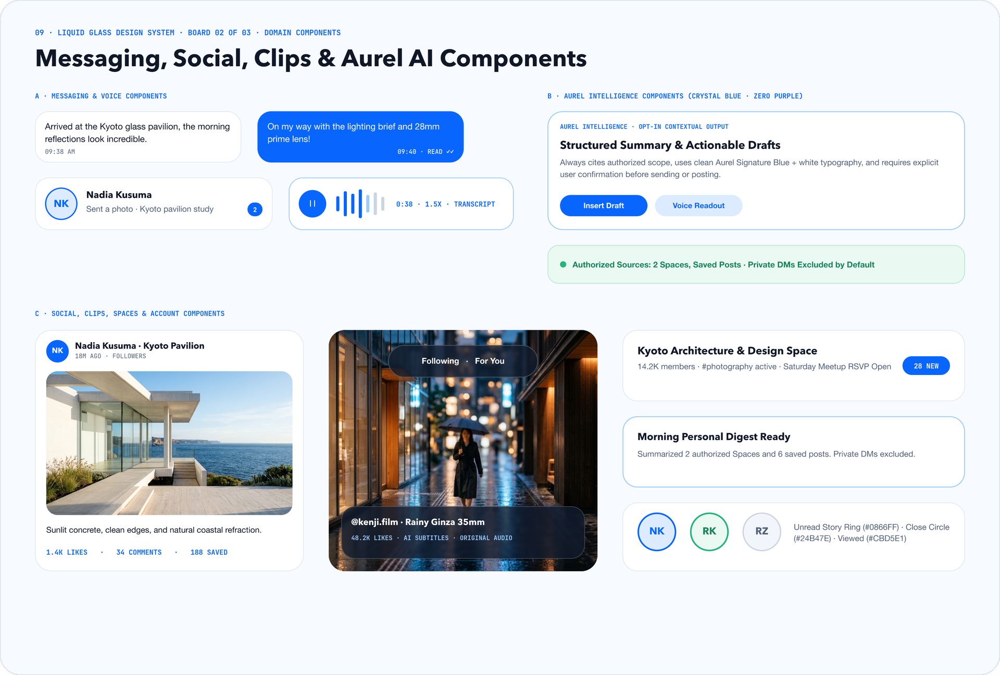
</p>

<p align="center">
  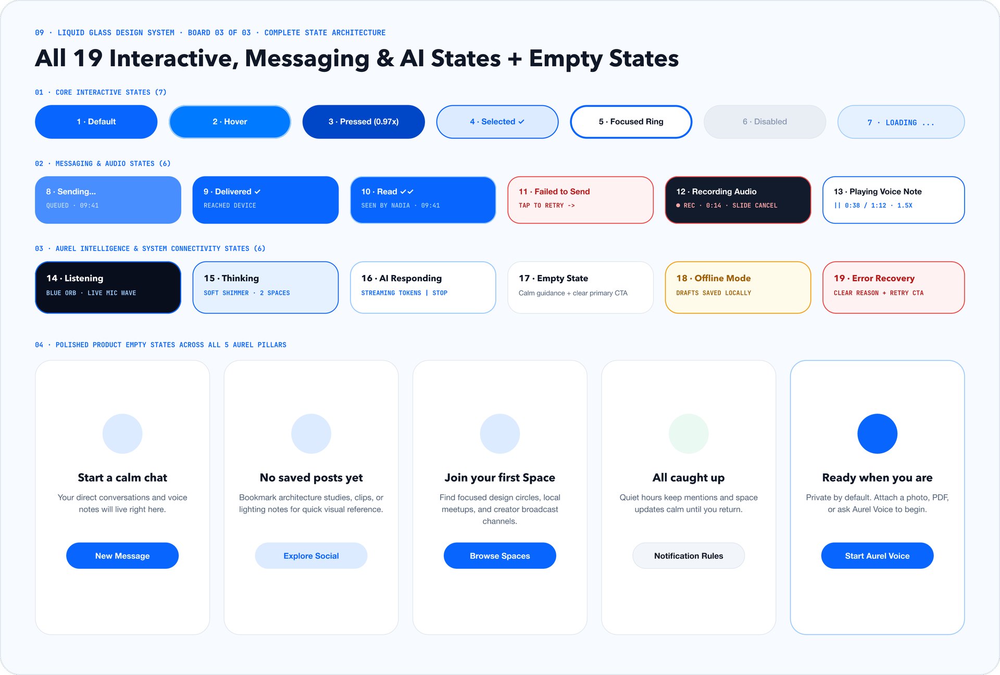
</p>

Full token tables and accessibility specs are documented in [`docs/DESIGN_SYSTEM.md`](docs/DESIGN_SYSTEM.md) and [`docs/ACCESSIBILITY.md`](docs/ACCESSIBILITY.md).

---

## Interactive Prototype & Motion

`AUREL-Social.figcraft` includes **7 clickable prototype flows** with **25 wired `proto.interaction.add` transitions** (`push`, `moveIn`, `smartAnimate`, and `dissolve`) alongside a 5-tier spring timing specification (`120 ms` micro-feedback through `500 ms` immersive media expansion) with Reduce Motion cross-dissolve fallbacks.

<table>
  <tr>
    <td align="center" width="34%">
      <picture>
        <source media="(prefers-reduced-motion: reduce)" srcset="previews/chats/05-chats-home.png">
        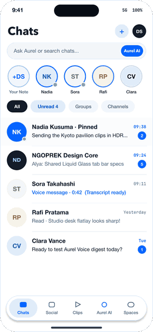
      </picture><br>
      <sub><strong>FigCraft Screen-Flow Sequence</strong><br>Compiled directly from exported AUREL artboards (not a live iOS runtime recording)</sub>
    </td>
    <td width="66%" valign="top">
      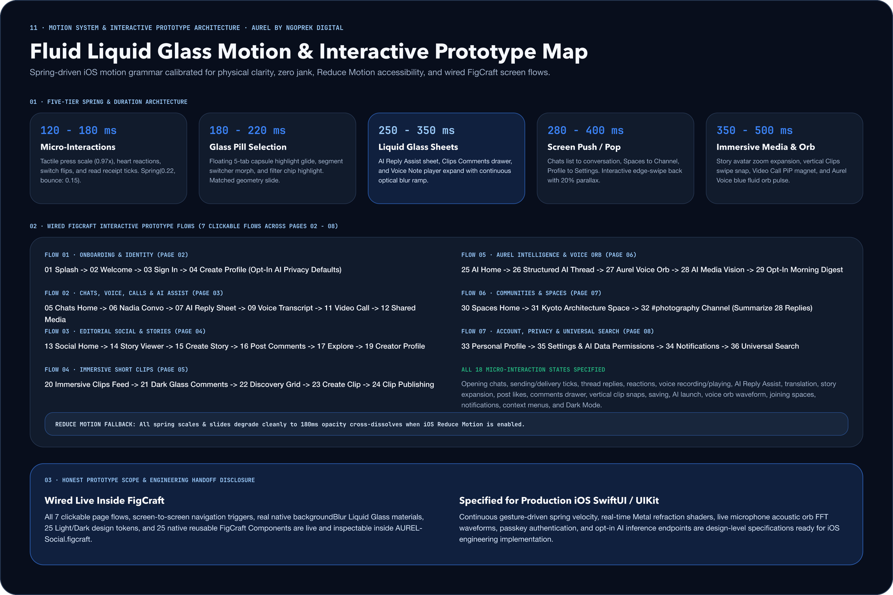
      <p><strong>Wired Prototype Flows in FigCraft:</strong></p>
      <ul>
        <li><strong>Flow 01 · Onboarding</strong>: <code>01 Splash -> 02 Welcome -> 03 Sign In -> 04 Create Profile</code></li>
        <li><strong>Flow 02 · Chats &amp; AI</strong>: <code>05 Chats -> 06 Conversation -> 07 AI Sheet -> 09 Voice -> 11 Video Call -> 12 Media</code></li>
        <li><strong>Flow 03 · Social</strong>: <code>13 Social -> 14 Story Viewer -> 16 Post Comments -> 17 Explore -> 19 Creator</code></li>
        <li><strong>Flow 04 · Clips</strong>: <code>20 Clips Feed -> 21 Dark Comments -> 22 Discovery -> 23 Create -> 24 Publish</code></li>
        <li><strong>Flow 05 · Intelligence</strong>: <code>25 AI Home -> 26 Thread / 27 Voice Orb / 28 Media Vision / 29 Digest</code></li>
        <li><strong>Flow 06 · Spaces</strong>: <code>30 Spaces Home -> 31 Community Details -> 32 #photography Channel</code></li>
        <li><strong>Flow 07 · Account</strong>: <code>33 Profile -> 35 Settings &amp; Privacy -> 34 Notifications -> 36 Search</code></li>
      </ul>
    </td>
  </tr>
</table>

See [`docs/MOTION_DESIGN.md`](docs/MOTION_DESIGN.md) and [`docs/PROTOTYPE.md`](docs/PROTOTYPE.md) for timing curves and click-through routes.

---

## Proposed Technical Architecture

> **Status: Proposed Blueprint Only (Not Implemented)**
> The architecture below outlines a production engineering plan for building AUREL beyond the design phase. No application code, API server, database schema, or cloud infrastructure exists in this repository.

<p align="center">
  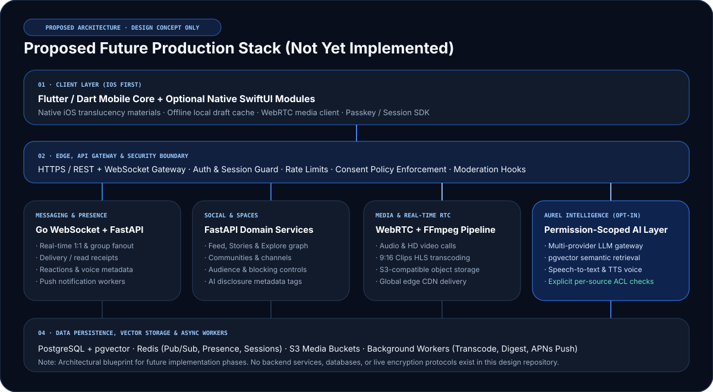
</p>

- **Mobile Client**: Flutter and Dart core with optional native SwiftUI bridges for iOS translucent material layers, haptics, and system passkeys.
- **Core Backend**: FastAPI domain services paired with Go WebSocket gateways for low-latency chat fanout, PostgreSQL persistence, Redis presence/sessions, and async workers.
- **Media Infrastructure**: WebRTC for audio/video calls, FFmpeg HLS transcoding for 9:16 Clips, S3-compatible object storage, and edge CDN delivery.
- **Contextual AI Layer**: Multi-provider LLM gateway, `pgvector` semantic retrieval, speech-to-text / TTS voice pipeline, and strict per-source permission enforcement excluding private direct messages by default.
- **Security & Privacy Controls**: Passkey and OAuth session architecture, explicit user consent gating, audience scoping, moderation/reporting workflows, and AI-assisted content disclosure labels.

Read the complete blueprint across [`docs/ARCHITECTURE.md`](docs/ARCHITECTURE.md), [`docs/PRIVACY.md`](docs/PRIVACY.md), and [`docs/SECURITY.md`](docs/SECURITY.md).

---

## Design Engineering Workflow

AUREL was designed live inside **FigCraft Desktop** using an AI-assisted design engineering workflow with human creative direction and continuous visual auditing:

- **Google Antigravity & FigCraft MCP**: Orchestrated live canvas creation (`FIGCRAFT_AUTO_LAUNCH=1`, `FIGCRAFT_STREAM_STEPS=1`) directly on the Desktop canvas without headless fallbacks or static HTML mockups.
- **FigCraft Desktop**: Authored all 12 pages, 25 variables, 25 native reusable components, live `backgroundBlur` glass materials, and 7 wired prototype flows in a single editable source file.
- **Astryx Design Principles**: Guided accessible spacing rhythm, `>= 44pt` touch ergonomics, WCAG AA contrast verification, and full interactive/empty/error state coverage.
- **Anti-Slop Quality Control (Mode 1: During)**: Prevented generic purple AI gradients, decorative emoji clutter, excessive glass blur on reading surfaces, and fabricated metrics; audited exported PNGs visually and resolved layout wraps before finalizing.

Full methodology is documented in [`docs/DESIGN_WORKFLOW.md`](docs/DESIGN_WORKFLOW.md).

---

## Getting Started (Authorized Collaborators)

This repository is **private** and contains design deliverables rather than compiled source code.

1. **Clone the private repository**:
   ```bash
   git clone https://github.com/dandisetiawanco/aurel-social.git
   cd aurel-social
   ```
2. **Open the editable design file** in FigCraft Desktop:
   - File path: `design/AUREL-Social.figcraft`
3. **Explore all 12 organized pages**:
   - Pages `01` through `08`: Brand identity and all 36 Light Mode screens.
   - Page `09`: Liquid Glass Design System, 25 native components, and all 19 states.
   - Page `10`: 8 Midnight Navy Dark Mode screens.
   - Page `11`: Motion architecture and 7 interactive prototype flows (`Shift+Space` or Present mode).
   - Page `12`: Editorial Product Showcase and `1280 x 640 px` social preview artboard.
4. **Review technical specifications**: Browse all 16 documents inside [`docs/`](docs/).

---

## Product Roadmap

| Phase | Milestone | Status |
| :--- | :--- | :--- |
| **Phase 01** | Product Design, Liquid Glass System &amp; FigCraft Interactive Prototype | **Completed** (`AUREL-Social.figcraft` + 54 exports + 16 docs) |
| **Phase 02** | Mobile Application Foundation (Flutter / Dart + SwiftUI Glass Bridge) | Planned |
| **Phase 03** | Real-Time Messaging (Go WebSocket Gateway, Receipts, Offline Sync) | Planned |
| **Phase 04** | Social Networking (Feed, Stories, Explore, Profiles, Disclosures) | Planned |
| **Phase 05** | Short Video Infrastructure (9:16 Clips, FFmpeg HLS, CDN) | Planned |
| **Phase 06** | Contextual AI Intelligence (Opt-In Gateway, `pgvector`, Voice Pipeline) | Planned |
| **Phase 07** | Voice &amp; Video Communication (WebRTC Calling, PiP, Live Captions) | Planned |
| **Phase 08** | Communities &amp; Creator Tools (Aurel Spaces, Channels, Events) | Planned |
| **Phase 09** | Security, Privacy &amp; Moderation (Auth, Encryption Architecture, Audits) | Planned |
| **Phase 10** | Production Deployment &amp; Telemetry Readiness | Planned |

Detailed engineering deliverables per phase are tracked in [`docs/ROADMAP.md`](docs/ROADMAP.md).

---

## Documentation Index

| Category | Documents |
| :--- | :--- |
| **Product &amp; Vision** | [Product Overview](docs/PRODUCT_OVERVIEW.md) · [Proposed Architecture](docs/ARCHITECTURE.md) · [Roadmap](docs/ROADMAP.md) |
| **Core Experiences** | [Messaging](docs/MESSAGING.md) · [Social Platform](docs/SOCIAL_PLATFORM.md) · [Short Video](docs/SHORT_VIDEO.md) · [AI Intelligence](docs/AI_INTELLIGENCE.md) · [Communities](docs/COMMUNITIES.md) |
| **Design &amp; Motion** | [Liquid Glass](docs/LIQUID_GLASS.md) · [Design System](docs/DESIGN_SYSTEM.md) · [Motion Design](docs/MOTION_DESIGN.md) · [Prototype Guide](docs/PROTOTYPE.md) · [Design Workflow](docs/DESIGN_WORKFLOW.md) |
| **Trust &amp; Quality** | [Privacy &amp; Consent](docs/PRIVACY.md) · [Security Architecture](docs/SECURITY.md) · [Accessibility](docs/ACCESSIBILITY.md) |

---

## Credits & Intellectual Property

Designed and directed by **NGOPREK DIGITAL** (*Connect. Collaborate. Create.*).

- **GitHub**: [https://github.com/dandisetiawanco](https://github.com/dandisetiawanco)
- **Personal Website**: [https://www.dandisetiawan.id/](https://www.dandisetiawan.id/)
- **NGOPREK DIGITAL**: [https://www.ngoprekdigital.site/](https://www.ngoprekdigital.site/)
- **Instagram**: [https://www.instagram.com/ngoprekdigital/](https://www.instagram.com/ngoprekdigital/)

Copyright © 2026 Dandi Setiawan / NGOPREK DIGITAL. All Rights Reserved. See [`LICENSE`](LICENSE) for proprietary terms.
