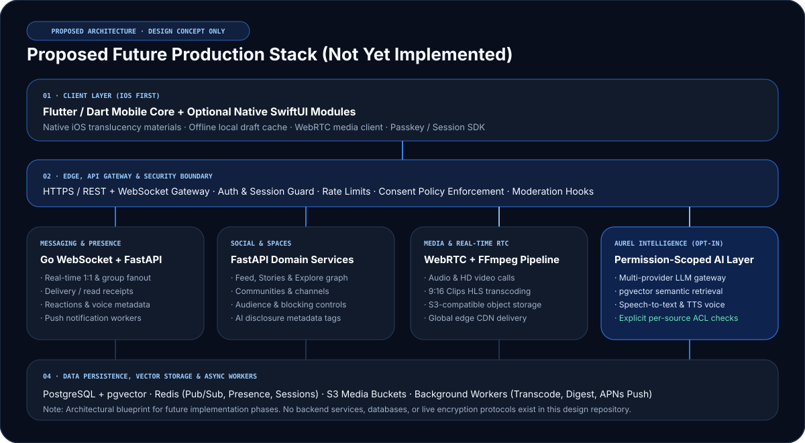

# Proposed Technical Architecture

> **Status Notice**: This document describes a **proposed technical architecture** for future engineering phases of AUREL. No mobile source code, backend APIs, media pipelines, databases, or live AI integrations exist in this private design repository.

---

## 1. Mobile Client Layer (iOS First)

- **Core Framework**: Flutter and Dart for shared state management, responsive mobile layout, and rapid multi-screen iteration aligned with the 25 AUREL design tokens.
- **Native iOS Integration**: Optional SwiftUI platform views for native iOS glass translucency (`Material.ultraThinMaterial`), system haptics, Picture-in-Picture video calling, and Apple Passkey authentication.
- **Local Resilience**: Encrypted local storage (SQLite / drift) for offline message drafts, cached conversation metadata, and instant optimistic UI transitions matching the `120 - 180 ms` micro-interaction spec.

## 2. Edge & API Gateway

- **Protocol Split**: HTTPS REST/JSON for feed queries, profile actions, settings, and media uploads; persistent WebSocket connections for chat delivery, typing state, presence, and live notifications.
- **Boundary Enforcement**: Token verification, per-user rate limiting, consent scope validation before forwarding requests to AI services, and moderation webhooks.

## 3. Core Backend Services

- **Messaging & Presence (Go + FastAPI)**: Go WebSocket fanout nodes for real-time delivery receipts (`Sending -> Delivered -> Read`), paired with FastAPI services for thread history, search indexing, and group membership.
- **Social & Spaces (FastAPI)**: Feed ranking, Stories expiration jobs, Explore curation, Space channels, event RSVPs, audience visibility filters, and AI-assisted content disclosure metadata.
- **Notification Workers**: Asynchronous workers dispatching Apple Push Notification service (APNs) alerts respecting user quiet hours and lock-screen preview privacy settings.

## 4. Media & Real-Time Communication Infrastructure

- **Real-Time Calling**: WebRTC SFU/TURN infrastructure supporting adaptive bitrate audio calls and 4K/HD video calls with Picture-in-Picture layouts.
- **Short Video & Photo Pipeline**: FFmpeg worker pool generating adaptive HLS renditions for 9:16 Clips, thumbnail extraction, and WebP/HEIF photo variants stored in S3-compatible object storage behind a global CDN.

## 5. Opt-In Contextual AI Layer

- **Multi-Provider LLM Gateway**: Model-agnostic orchestration layer routing text summarization, translation, vision analysis, and structured drafting while avoiding vendor lock-in.
- **Permission-Scoped Retrieval (`pgvector`)**: Semantic embeddings indexed strictly for user-authorized sources (selected Spaces and saved posts). A hard policy guard excludes private direct messages unless a user explicitly invokes per-message assistance.
- **Voice Pipeline**: Streaming speech-to-text (STT) for live transcription during Aurel Voice and voice-note playback, paired with low-latency text-to-speech (TTS) for optional Voice Readout.

## 6. Data Persistence

- **PostgreSQL + `pgvector`**: Relational source of truth for users, relationships, posts, Spaces, consent records, and scoped vector embeddings.
- **Redis**: Ephemeral presence state, WebSocket pub/sub routing, rate-limit counters, and session caching.
- **S3-Compatible Object Storage**: Durable storage for raw uploads, transcoded Clips, voice notes, and shared PDF attachments.
